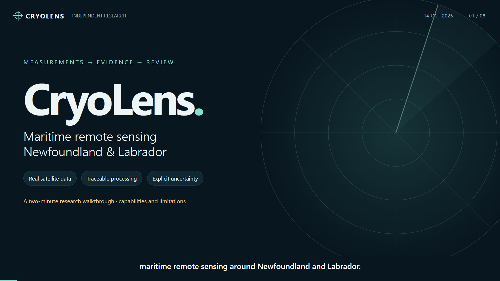

# CryoLens

**Auditable satellite radar candidate screening for the Newfoundland and Labrador shelf.**

## Watch the two-minute walkthrough

**Research prototype:** the reference set remains incomplete. Target precision,
recall and empirical false alarms are unmeasured; ship/iceberg identification is
unvalidated. No operational or navigational use is claimed.

https://github.com/user-attachments/assets/0aae9c27-022f-4cc1-be55-71d5475b4b80

[**Download the original 2:00 video**](https://github.com/haseebkn/CryoLens/releases/download/v0.1.0-research.3/CryoLens-two-minute-walkthrough.mp4)
· [Transcript](https://github.com/haseebkn/CryoLens/releases/download/v0.1.0-research.3/TRANSCRIPT.txt)
· [Subtitles](https://github.com/haseebkn/CryoLens/releases/download/v0.1.0-research.3/CryoLens-walkthrough.srt)
· [Evidence report](https://github.com/haseebkn/CryoLens/releases/download/v0.1.0-research.3/CryoLens-v0.1.0-research.3-portfolio.pdf)

<details>
<summary>Linked thumbnail and direct playback fallback</summary>

[](https://github.com/user-attachments/assets/0aae9c27-022f-4cc1-be55-71d5475b4b80)

</details>

The captioned walkthrough shows real review interfaces, recorded processing/model
evidence and an actual CPU inference request. Narration is synthetic; the review
interaction is a demonstration draft, not a human submission or live surveillance.

The U-Net/frozen-CROMA experiment measures sea-ice chart agreement, with no
reliable winner or protected final-test result. Status shown: **14 October 2026**.

CryoLens is a research portfolio project for maritime remote sensing. It uses
Sentinel-1 HH/HV imagery to find bright radar targets, suppress common clutter,
and show evidence for analyst review. A detected target is **unclassified and
unverified** until reviewed. A detector score is not the probability of an iceberg.

**The intended scope has not changed:** develop and evaluate an auditable
maritime domain awareness workflow for the Newfoundland and Labrador marine
study area, with low false positives **and measured missed-target risk**. Target
detection, sea-ice segmentation and ship/iceberg identification remain distinct
tasks. The current research release is an intermediate delivery toward that
goal, not a replacement of it or a claim that the operational goal is complete.

Public Sentinel imagery and AI4Arctic sea-ice chart labels have enabled real
processing, screening, model experiments and review tooling. What is still
missing is sufficient **verified, acquisition-matched regional target truth**
and useful corroborating observations to establish ship/iceberg identity and
regional detection performance. We have not established that no such public
data exists; the evidence assembled so far is insufficient. Human reference
review and other implementation/evaluation work also remain unfinished, so
data availability is **not the sole explanation** for the remaining gaps.

## Current research release - 14 October 2026

[**v0.1.0-research.3: report, portable demo and evidence**](https://github.com/haseebkn/CryoLens/releases/tag/v0.1.0-research.3)
packages software from merged PR #18, including the review-saving and IIP
publisher CSV fixes. Start with the
[five-page evidence report](https://github.com/haseebkn/CryoLens/releases/download/v0.1.0-research.3/CryoLens-v0.1.0-research.3-portfolio.pdf),
[five-minute offline demo](https://github.com/haseebkn/CryoLens/releases/download/v0.1.0-research.3/CryoLens-v0.1.0-research.3-demo.html)
and [speaker script](https://github.com/haseebkn/CryoLens/releases/download/v0.1.0-research.3/CryoLens-v0.1.0-research.3-five-minute-script.txt).
Download the HTML and open it locally; it presents recorded results, not live
inference or surveillance.

The [portable ZIP](https://github.com/haseebkn/CryoLens/releases/download/v0.1.0-research.3/CryoLens-v0.1.0-research.3-portable-demo.zip)
contains a separate executable U-Net inference check. It reused the isolated
Windows Python 3.11 CPU environment and installed wheel from the research.2
verification, with unchanged dependencies rather than a new full dependency
install this round; HTTP inference reproduced one qualified development
prediction with maximum absolute difference **1.19e-7**, below the unchanged
**1e-5** tolerance. Follow its `START-HERE.md`; first-time dependency setup
needs internet, but no credentials, GPU or Docker. This verifies that
demonstration, not fresh-SAFE model suitability or accuracy.

### Roadmap: demonstrated progress and remaining work

| Step | Demonstrated by this release | Still remaining |
|---|---|---|
| **1. Scope and evaluation rules** | Versioned NL polygon, grouped acquisition partitions, task/annotation rules and provenance tracking. | Preserve the protected model test; disclose reference-only and AI-assisted exposure. |
| **2. Fresh Sentinel-1 processing** | Representative complete EW and IW outputs passed recorded SNAP comparisons and quality checks; fixed 5% HV non-positive limit unchanged. | Regional/seasonal operational qualification and the separate fresh-target deployment gate remain open work. |
| **3. Sentinel-2 paired review** | Planetary Computer and CDSE ingestion, quality layers, paired review and provenance. Of 18 predeclared review locations, 5 had optical context, 1 passed strict visibility, and 0 had a strict useful view covering the full assumed movement envelope. | Useful matched optical coverage and human corroboration remain limited; these locations are not confirmed detections. |
| **4. Independent reference set - partial** | 64 accepted pilot primary dispositions, including 5 adopted corrections: 62 complete cores, 1 partial, 1 unusable; 1 observable target and 1 uncertainty, both identity unknown. | 13-tile consistency review, adjudication and freeze; separate 193 development survey tiles and 96 candidate reviews have no formal human submissions. AI assistance is disclosed. |
| **5. U-Net / frozen CROMA - preliminary** | Executed chart-proxy experiment: 960 training chips, 160 validation chips, grouped acquisitions, one seed, six epochs. | Representative multi-seed evaluation and protected final-test evaluation; 149/160 validation chips contain one chart class, so no reliable winner is established. |
| **6. Full-pipeline measurement - incomplete** | Candidate counts, suppression accounting and evaluation tooling. | Reference-backed precision, recall, per-stage recall and empirical false alarms with uncertainty; iceberg-identification accuracy is also unknown. |
| **7. ML lifecycle - research demonstration** | MLflow tracking, registry/signatures, CPU serving and witnessed promotion/rollback. | Operational monitoring, shadow evaluation and justified retraining require qualified deployment and evidence. |
| **8. Research packaging - delivered** | Tagged prerelease, model card, checksums, clean CPU demonstration, evidence report and timed walkthrough. | Continued scientific validation; this is not an operational or navigational release. |

The pilot's concealed consistency review is eligible after **20 October 2026,
22:50 Newfoundland time**, under the recorded review dates; further genuine
reviews can move that date. Accepted pilot work is retained, not discarded.
The release preserves historical scientific receipts with their original
execution identities; packaging did not rerun training or evaluate the
protected final model test.

### Why the remaining gaps exist

- **Target truth:** AI4Arctic labels sea ice, not individual ships or icebergs.
  IIP reports provide context; they are not automatically acquisition-matched
  target truth. Obtain suitably matched, traceable observations and expert
  review; permissioned partner data may help if public sources prove inadequate.
- **Optical visibility and timing:** Sentinel-2 is public, but clouds, shadows,
  resolution, acquisition separation and movement restrict useful corroboration.
  Expand matched searches and report unavailable evidence explicitly; a missing
  optical counterpart must never automatically make a radar target false.
- **Human reference work:** existing imagery can support more review now.
  Finish consistency review, retained/rejected sampling and independent area
  searches, then adjudicate and freeze scored coverage. This is unfinished work,
  not solely a public-data access problem.
- **Model and deployment maturity:** chart-proxy/domain limitations, limited
  experiments, unconnected AIS, absent trained ship/iceberg identification,
  disabled drift and unimplemented operational monitoring need further engineering
  and validation. None becomes complete merely by downloading more imagery.

## Historical screening result - not target accuracy

The September 2026 audit found errors in preprocessing, geographic coverage,
classification claims and evaluation. Earlier headline results are withdrawn;
see [benchmark status](docs/BENCHMARK.md) and the [audit](docs/AUDIT.md).
Precision, recall and a real-world false-positive rate have **not** been established.

Across **25 Sentinel-1 acquisitions** (28 eligible, 3 fully masked by the
conservative open-water filter), the screening path retained **311 unverified
candidates** over **1,670,147 km²** of cumulative eligible coverage, or 0.186
per 1,000 km². This is a reproducible screening result, not a validated regional
false-alarm budget.

It supersedes an earlier three-acquisition smoke run: retained density rose
from 0.108 to 0.186 per 1,000 km² and the suppression factor fell from 38.9x
to 19.4x once coverage grew five-fold. These changes show sensitivity to
coverage; without target truth, they do not establish better or worse accuracy.
They are historical screening measurements, not new measurements from the
research.3 release.

## Maritime domain awareness

The project separates SAR target detection, ship/iceberg identification and
human quality control. It is an independent research project, with no claim
of operational certification or third-party endorsement. The
[MDA alignment](docs/MDA_ALIGNMENT.md) maps public guidance to implemented
behavior and identifies the missing operational capabilities.

## What you can inspect

- CA-CFAR and Gamma-CFAR statistics in linear power, with explicit nodata handling.
- A shared NL study polygon used for pixel-level analysis and API filtering.
- Land/coast, border, seam and optional sea-ice exclusion; an auditable suppression ledger.
- Unclassified candidate geometry and radiometry, source timestamps and review provenance.
- A FastAPI/Leaflet analyst dashboard with bounded queries and protected review writes.
- Real Sentinel-2 RGB/NIR/SCL native crops, paired radar/optical review and separate optical evidence history.
- Tests, type checks, dependency locking, database migrations and real PostGIS checks in CI.

**Gamma-CFAR is not a K-distribution detector.** The historical `k_distribution`
configuration value is retained only as a compatibility alias. The default is `gamma`.

## Quickstart

Python 3.11, [uv](https://docs.astral.sh/uv/) and Docker are needed for the full
local app. Run from the repository root. These commands work in PowerShell
and POSIX shells; use your shell's copy command for `.env.example`.

```text
uv sync --frozen --extra dev
```

Copy `.env.example` to `.env`, set a local `POSTGRES_PASSWORD`, then:

```text
docker compose up -d postgis
uv run --frozen alembic upgrade head
uv run --frozen uvicorn cryolens.api:app --host 127.0.0.1 --port 8000
```

Open [the dashboard](http://localhost:8000) or [the API docs](http://localhost:8000/docs).
An empty database is shown as empty; the app does not manufacture detections.
For an interview walkthrough, use [PORTFOLIO.md](docs/PORTFOLIO.md).

With the public archive downloaded, import the first labeled example:

```text
uv run --frozen python scripts/import_ai4arctic_scene.py --scene data/raw/ai4arctic/train/20180331T212355_cis_prep.nc
```

This imports a historical 2018-03-31 observation, not a live feed. Select
**Unverified SAR candidates** in the dashboard to inspect its six candidates;
the default confirmed-only view correctly shows none until an analyst reviews
the evidence. Re-importing preserves existing records and reviews.

Review writes are disabled until both `CRYOLENS_ANALYST_API_KEY` and
`CRYOLENS_ANALYST_ID` are configured locally. Never put credentials in Git,
screenshots or presentation materials. Bind locally for a demo; production
hosting and identity management have not been assessed.

## Real data and evaluation

The local evaluation uses the public
[AI4Arctic ready-to-train dataset](https://data.dtu.dk/articles/dataset/Ready-To-Train_AI4Arctic_Sea_Ice_Challenge_Dataset/21316608),
which contains Sentinel-1 scenes and **sea-ice charts, not iceberg truth**.
The publisher's normalization must be inverted using its documented constants;
scene extrema alone cannot establish physical units. All results depend on
that data contract and the masking assumptions documented in the benchmark.

```text
uv run --frozen python -m cryolens.eval --help
uv run --frozen python -m cryolens.detect --help
uv run --frozen python -m cryolens.preprocess --help
```

For an existing HH/HV SAFE product, ordinary Python preprocessing writes a
complete corrected research COG and separate source/output receipts into a new
product directory under `--output-dir`:

```text
uv run --frozen python -m cryolens.preprocess --engine python --scene path/to/product.SAFE --output-dir data/processed/new-run
```

Use a fresh output location for each run; occupied product directories are
refused. See the [processing contract and reference workflow](docs/processing-validation/v5/README.md)
for memory controls, fixed output geometry and the separate detection release.

Raw imagery, credentials, trained weights and generated databases are excluded
from Git. GSHHG shorelines are public and are required by the raw COG detection
path (`make fetch-shorelines` on systems with Make). See
[DATA.md](docs/DATA.md) for access and provenance.

The raw SAFE/COG path lacks aligned sea-ice context and requires explicit
unknown-ice research opt-in (`--allow-unknown-ice` for the detection CLI,
`PipelineRunner(allow_unknown_ice=True)` in Python). The charted public-scene
import above uses conservative open-water screening by default.

## Acquisition mode and coverage

Measured against the CDSE catalogue on 2026-09-16, counting Sentinel-1 products
intersecting each area across the 2020, 2024 and 2026 February-July seasons:

| Area | EW GRDM HH+HV | IW GRDH |
|---|---:|---:|
| Grand Banks | **0** | 100+ |
| NE Newfoundland Shelf | **0** | 100+ |
| Labrador Shelf | 100+ | 100+ |
| Labrador Sea (north) | 100+ | 100+ |

**Extra Wide swath does not cover the southern half of the study area.** ESA's
acquisition plan uses EW over ice-affected Labrador waters and IW further south.
An earlier version of this project asserted the opposite. IW over the Grand Banks
is roughly 76 percent dual-pol HH+HV, so the polarimetric basis survives.

The reader supports annotated IW GRD HH/HV measurements. The
[current processing report](docs/processing-validation/v5/README.md) owns the
representative EW/IW outcomes and remaining qualification requirements.
**Operational southern NL coverage remains unvalidated**;
successful downloading and mode parsing do not establish detection coverage.

## Geographic scope

The hand-defined study polygon covers the Labrador coastal corridor, Northeast
Newfoundland Shelf and Grand Banks. It is stored in `configs/aoi.geojson` and
bounded by 60.5°W–44°W, 42.5°N–60.5°N. It is **not a provincial boundary or EEZ**.
Land and coastal exclusion are separate from this marine research area.
Intersecting scenes may be loaded, but pixels and candidate centres outside
the study area are excluded. Coverage is reported as analyzed area; masked
water is not evidence that no icebergs are present.

## Validation

The [frozen evaluation protocol](docs/EVALUATION_PROTOCOL.md) defines separate
detection, sea-ice segmentation and identification tasks, acquisition groups,
development/test partitions and real MLflow tracking. Its
[coverage map](docs/evaluation/v1/coverage.png) shows acquisition footprints;
eligible surveyed water remains a separate measurement.

The [independent reference workflow](docs/REFERENCE_SET.md) prepares whole-area
surveys before retained/rejected candidate review, records sampling probabilities,
and supports concealed repeats, adjudication and exact coverage masks. The
[real pilot](docs/reference-set/v1/README.md) has 193 development survey tiles,
28 retained and 68 sampled rejected reviews, and 64 held-out survey tiles.
The [correction implementation report](docs/reference-set/corrections-v1/README.md)
retains its historical pre-adoption status. The later
[research.3 evidence report and receipts](https://github.com/haseebkn/CryoLens/releases/tag/v0.1.0-research.3)
record 64 accepted pilot primary dispositions and five adopted amendments,
not 69 independent reviews. **Reference completion
remains pending; no reference-derived precision, recall or false-alarm rate is
available.** January test SAR was prepared for human reference review
only; its chart labels and model evaluation remain sealed.

See the [current SAFE processing evidence](docs/processing-validation/v5/README.md)
for authentic downloads, representative passing products, retained rejections
and the separate regional deployment and scientific-release gates.
The [prior processing corrections](docs/processing-validation/v2/README.md)
remain documented.

The [qualified EW/IW optical-review report](docs/optical-review/fresh-v1/README.md)
owns the current measured coverage, strict screening receipts and commands for
the separate fresh analyst interface. Its predeclared spatial locations are
review context; fresh target detection remains blocked. Human optical review
and reference completion remain separate from software workflow completion.
Missing optical evidence never automatically rejects a radar candidate.

The earlier [AI4Arctic paired-review pilot](docs/optical-review/v1/README.md)
and [CDSE alternative-provider report](docs/optical-review/cdse-v1/README.md)
retain their historical measurements and candidate-dashboard workflow.

```text
uv run --frozen pytest
uv run --frozen ruff check .
uv run --frozen ruff format --check .
uv run --frozen mypy src tests
uv run --frozen python scripts/check_postgis.py
uv build
```

The PostGIS check requires the migrated local database and rolls back its
fixtures. Unit tests also use SQLite substitutes; those alone do not verify
PostGIS. Real-data integration tests skip explicitly when their source files
are absent. CI uses locked dependencies and a real PostGIS service.

## Capability boundaries

| Capability | Honest status |
|---|---|
| Statistical radar candidate screening | Implemented; thresholds require regional validation |
| Analyst review and geographic API | Implemented; local API-key protection |
| Independent target references | Real packets and human review underway; repeat review and adjudication pending. AI assistance must be disclosed; see the [roadmap audit](docs/ROADMAP_AUDIT.md) |
| Sentinel-2 paired review | Planetary Computer and CDSE providers; verified original SAFE alternative, native crops, cloud/shadow/valid-data screening and separate attributed evidence; pilot coverage is limited |
| SAFE EW/IW calibration and geolocation | Marine range-Doppler, EGM96 height, residual timing and matched SNAP checks; see [current validation](docs/processing-validation/v5/README.md). Absolute geolocation accuracy is not established |
| ESA standard thermal noise removal | Sampled agreement does not establish usable observations; see the [current processing outcomes](docs/processing-validation/v5/README.md) |
| Fresh SAFE detection deployment | Blocked by separate processing-quality and scientific-release gates; no current producer grants a release |
| Precise-orbit acquisition | Implemented; POEORB/RESORB fetched from public ESA/ASF mirrors, no credentials needed |
| Precise-orbit **correction** in Python pipeline | Not applied; marine geocoding uses annotated orbit/range metadata and records that source |
| Trained ship/iceberg classifier | Not implemented |
| Live AIS deconfliction | Not connected; no match does not establish iceberg identity |
| Drift prediction / grounding | Disabled; verified forcing and skill assessment missing |
| Navigational warnings / hazard advisories | Not produced |

Reducing candidate counts can also remove real icebergs. The project does not
claim that its thresholds minimize false positives or preserve recall.
[Limitations](docs/LIMITATIONS.md) describe the evidence needed to make those claims.

## Structure

```text
src/cryolens/
  config/       validated settings; credentials remain local
  ingest/       satellite catalogues, download/cache, IIP context
  preprocess/   SAFE calibration, geolocation, coast masks, COG stack
  data/         AI4Arctic data contract and scene index
  detect/       CFAR, suppression, scene runner, training export
  geo/          shared NL area and target geometry
  eval/         candidate-density reports and contextual matching
  review/       Sentinel-1/Sentinel-2 pairs, native crops and optical visibility
  api/ db/ web/ analyst interface, persistence and provenance
  drift/        explicit unavailable interfaces
```

Software: [MIT](LICENSE). Source datasets retain their own terms.
No output is suitable for navigation or an ice-hazard advisory.

## Preliminary sea-ice model research

The [development comparison and model card](docs/segmentation/v1/README.md)
record actual U-Net and frozen-CROMA training on chart proxies, followed by a
local MLflow/Docker promotion and rollback. Pooled validation mean IoU was
0.9185 and 0.9309, but 149/160 chips are homogeneous chart interiors; mixed-chip
results are much lower and group macro scores are essentially tied. Test data
remain protected. This is preliminary chart agreement, not target accuracy,
regional operating performance or an iceberg classifier.
