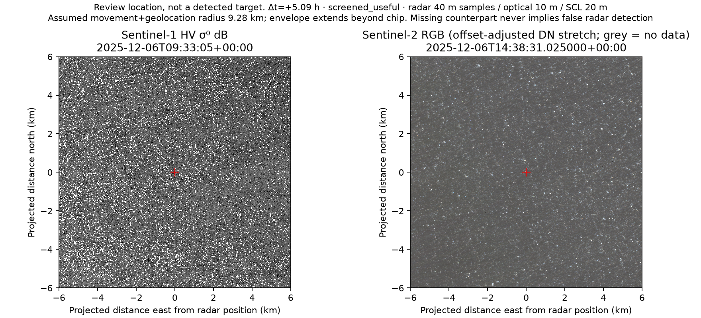

# Qualified SAFE / Sentinel-2 paired review

Executed 13 October 2026 using the already qualified complete EW and IW outputs from [step 2](../../processing-validation/v5/README.md). The original thresholds, raw products, processing receipts, frozen test partition and pilot annotation ledgers are unchanged.

## Measured coverage

The plan was frozen before either optical catalogue was queried. A regular 5 by 5 grid over each corrected raster yielded 8 eligible northern Labrador EW locations and 10 Grand Banks IW locations after NL-polygon, finite-radar and 500 m GSHHG coastal-buffer checks. These are spatial review locations, not detections, selected targets, a probability sample of NL waters or an area-weighted regional coverage estimate.

| Quantity | EW | IW | Combined |
|---|---:|---:|---:|
| Predeclared eligible marine locations | 8 | 10 | 18 |
| Locations with downloaded optical context | 0 | 5 | 5 (27.8%) |
| Locations passing the 80% visibility screen within the displayed disk | 0 | 1 | 1 (5.6%) |
| Screened locations with the full assumed movement envelope inside the chip | 0 | 0 | 0 |

Both Planetary Computer and CDSE queries completed: zero optical products overlap the EW search geometry within the unchanged +/-12-hour window; 11 overlap the IW search geometry. That geometry is the NL-clipped corrected raster bounding rectangle, including nodata, so catalogue counts are not valid-pixel coverage. All 18 location queries are represented, including no-coverage cases. There were no final native-asset read failures, incomplete catalogue searches or item-selection truncations in the Planetary Computer execution.

Eight actual optical tile/location pairs were downloaded for five IW locations. Along with 13 unavailable-evidence contexts, this yields 21 paired manifests. Multiple tiles at a location are not independent observations or targets. Native B02/B03/B04/B08 and SCL data preserve their respective 10 m and 20 m grids and are available through the analyst interface.

The best-screened location is 46.932078 N, 52.495381 W. Its tile 22TCT has 99.896% screened visibility inside the displayed disk. Sentinel-2C observed it at 2025-12-06 14:38:31.025 UTC, **5.0906 hours after SAR**. The existing 0.5 m/s movement preset plus geolocation allowances gives **9.283 km**, exceeding the fixed **6 km** chip radius. This is useful inspection context within the chip, not full displacement coverage. **It cannot support a no-visible-counterpart claim under the existing checks.** The motion preset is not a vessel speed bound or a measured drift forecast.



[Coverage](coverage.json), [frozen selection](selection.json), [configuration](configuration.json), catalogue receipts and [all pair manifests](pair-manifests.zip) preserve the observations. No optical or iceberg truth is manufactured. No human corroboration was entered; visual preview during implementation was layout/data-display QA only.

## Direct CDSE verification

The strongest-screened example was selected **after** screening solely for provider verification, not as a second availability sample. Using the existing CDSE login, the actual Sentinel-2C L2A tile 22TCT SAFE archive (1,154,813,233 bytes) downloaded and passed its catalogue byte/checksum, ZIP CRC and SAFE manifest checks. See [verification](cdse-direct-verification/cdse-verification.json) for the exact algorithms checked and any advertised checks not checked.

The match is **exact_product**, and [native comparison](cdse-direct-verification/comparison.json) establishes exact equality of raw arrays and source masks across B02, B03, B04, B08 and SCL, with identical native grids. Each optical band has approximately 2.81 million jointly valid matched pixels; SCL has 703,082. No additional resampling was used for the comparison. This is one product/crop integrity demonstration, not proof of provider-wide equivalence or target identity.

All 21 pair manifests and their assets were rehashed. Every radar crop value was independently compared against its window in the qualified complete source raster: **3,907,050 values match**, including nodata, with identical affine grids. Both original qualified whole-raster SHA256 values still match. See [artifact verification](artifact-verification.json).

## Processing and evidence boundary

The fresh reader requires the exact SHA256-qualified step-2 output, complete-raster acceptance, nine passed reference windows per source, unchanged numeric quality limits and the expected EPSG:3978/40 m four-band grid. It preserves that affine grid when cropping; it does not approximate the corrected raster with a new GCP warp. HH/HV nodata is preserved and original corrected raster hashes are checked before and after pairing.

Review sampling does not execute CFAR, claim a SAR target at the red cross, enable fresh target detection, or change the independent pilot. Optional analyst corroboration requires a personally inspected SAR position in both HH/HV channels and an optical position with valid, non-obscured pixels inside the matching allowance. Explicit absence evidence additionally needs complete screened displacement coverage about the SAR position. An offset position requires a newly centred pair before absence can be recorded. Identity remains unknown; these optical observations do not silently establish ship or iceberg truth.

The local analyst application uses the existing named-analyst API-key authentication. Evidence is appended to its own hash-chained ledger under the optical run, separately from pilot annotations; earlier records cannot be updated or deleted. Missing credentials disable evidence writes. Native/aligned imagery and provenance remain readable. Positions should be inspected in georeferenced native imagery, for example in QGIS; display stretching and 10 m alignment do not increase radar information content.

The fresh optical path is an additional analyst interface. The original candidate dashboard and AI4Arctic pair producer remain available; no fake detections are inserted into their database. The reference-set/model-release gates remain separate.

## Reproduce

From the checkout, with the validated source files available, use a new output root:

```powershell
python -m cryolens.review.fresh prepare --config configs/optical-review-fresh-v1.json --root E:/new-fresh-optical
python -m cryolens.review.fresh search --root E:/new-fresh-optical
python -m cryolens.review.fresh generate --root E:/new-fresh-optical --provider planetary-computer
python -m cryolens.review.fresh serve --root E:/new-fresh-optical --provider planetary-computer --port 8019
```

The committed configuration records actual workstation paths. For another installation, create a new versioned configuration with its source locations and identical scientific policy. Preparation reserves the root, verifies sources and seals the spatial sample plus executing source snapshot before querying. Search and generation refuse existing receipts/output directories and changed source/configuration. Interrupted runs remain as evidence; replacement executions use a new root. `--provider cdse` offers direct SAFE-backed pair generation with the existing CDSE credentials and explicit archive budgets; it is never a silent fallback.

All source rasters and local optical crops remain outside Git. Executed code and scientific receipts retain their original bytes rather than claiming that a future review commit ran them. The standalone CDSE comparison has its own later execution snapshot; extending that adapter did not modify the earlier Planetary Computer outputs.

For analyst writes, configure `CRYOLENS_ANALYST_ID` and `CRYOLENS_ANALYST_API_KEY` in the local server environment; enter the key in the review form. Keys are not stored in browser local storage or committed. An analyst's clear-visibility judgment is additional evidence, not inferred from SCL alone.

## Completion and limits

Step 3 now has receipt-bound fresh EW/IW pairing, actual optical downloads, explicit measured availability, preserved native data, and an authenticated inspection/evidence workflow. Broad all-season NL availability and target identity accuracy are not established by two selected SAR products or 18 locations. Actual human optical observations remain part of reference building. None are required to be invented to call the software/data workflow complete.

## Software verification

The complete unit suite passed 609 tests before the final direct-verification and cloud-buffer additions. The subsequent 22-test focused run and final nine fresh-workflow regressions passed. Typing covered 158 maintained source/test/validation files; lint and format checks passed. The native delivery pipeline performs final-head review, checks and CI separately. Fixtures are synthetic and isolated; they do not add human evidence to the real review workspace.

The browser workflow was exercised against the actual live report, including selecting the screened IW pair and displaying its native downloads and incomplete-envelope warning. No personal-inspection form was submitted during implementation. Follow-up reviewer validation also enforces the original 60 m cloud/shadow buffer around an observed optical point. That stricter write guard does not alter stored pixels or the earlier coverage measurements.
