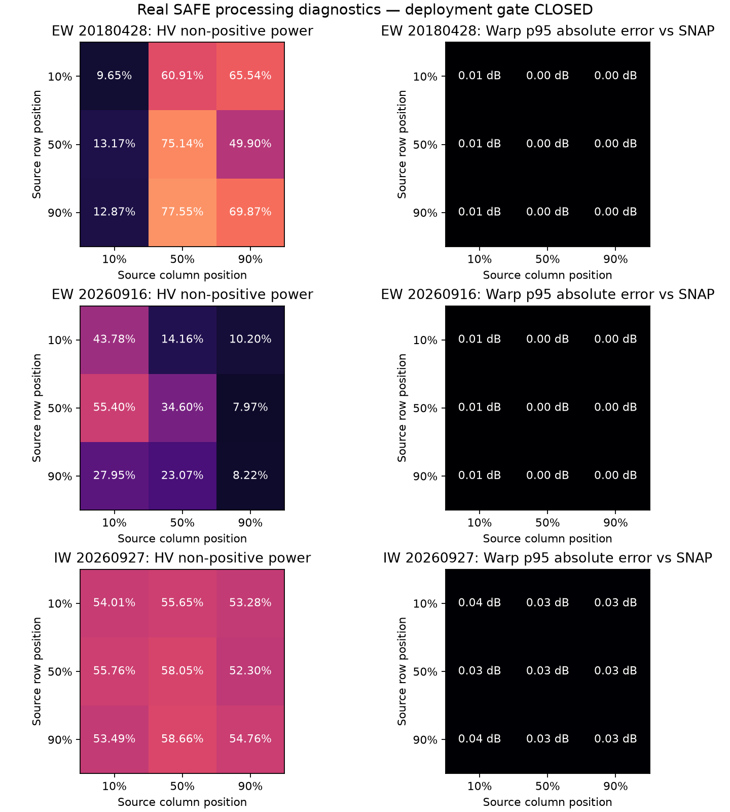

# Marine Sentinel-1 processing correction, v2

**The fresh-observation deployment gate remains closed.** This investigation
corrects processing and reference-workflow errors while retaining every v1
quality and comparison threshold. It does not qualify noise-limited data by
clipping, filling, dropping valid negative pixels or reducing noise amplitudes.

## Corrections

1. **Height datum and geocoding:** annotation-GCP warping was an approximation
   to a different surface. The SNAP reference with these settings uses EGM96
   sea-surface height when the annotated scene-height value is zero. Marine
   processing now solves zero-Doppler time from the declared Earth-fixed orbit,
   inverts annotated ground/slant-range polynomials and uses that same explicit
   mean-sea-surface height. The auxiliary grid is pinned and packaged, with
   [its measured retrieval checksum](../../../configs/auxdata/egm96/README.md).
2. **Timing:** the declared Sentinel-1 IPF bulk correction is referenced to
   near range. The remaining range-dependent propagation delay is applied using
   the original full-product reference range. No image displacement is fitted.
3. **Resampling:** the new path samples bilinear point values in linear power,
   then converts to dB and derives the HH/HV ratio. GDAL's scale-dependent warp
   kernel was not equivalent to the reference's point interpolation, particularly
   when going from 10 m IW spacing to 40 m output spacing. Missing or invalid
   interpolation support remains nodata in all four bands.
4. **Reference cropping:** the old graph cropped before range-Doppler processing.
   SNAP's subset changes near-range metadata, including the range used by the
   residual timing correction. V2 geocodes the full acquisition geometry and
   crops the output afterward. Raw calibration and signed noise comparisons still
   use matched source windows. **The old cropped-reference geometry acceptance
   decisions are superseded; they cannot validate the current marine path.**
5. **Short noise blocks:** a real September 11 development acquisition has an
   EW3 azimuth block spanning lines 224–322 with no interior range-noise vector.
   The reader now selects the nearest qualified vector within the declared
   subswath extent, retaining its measured range knots. It does not synthesize
   noise when no qualified annotation is available. The historical SNAP comparison
   reported agreement better than 0.00001 dB with no residual-sign mismatch, but
   its incomplete consumed-input receipt invalidates that acceptance claim.
   The separate [short-block v3 report](short-block-v3/report.json) records that
   new execution with a complete consumed-input inventory and current source
   snapshot; it claims calibration and signed-noise agreement only.
6. **Nodata borders:** noise coverage is required for every actual valid
   measurement. Unannotated padding is allowed only where the raster mask or
   zero-DN declaration already establishes nodata. A valid observed pixel without
   noise annotation still rejects the input. The 10% minimum measurement coverage
   and 5% maximum non-positive fraction are unchanged.

The operational preprocessing entry points use the new marine mapping and export
its annotation, geoid, timing and resampling provenance. The GCP helper remains
available for explicit experiments. Unsupported timing, nonzero reference terrain
heights, incomplete orbit/range metadata and failed convergence are handled
explicitly. Precise-orbit adjustment, terrain normalization, tidal correction and
independently surveyed absolute geolocation are not established.

## Scientific references

The formulas and conventions follow the publisher's
[Sentinel-1 geocoding guide](https://sentinels.copernicus.eu/documents/247904/1653442/Guide-to-Sentinel-1-Geocoding.pdf),
particularly the range-dependent bistatic timing discussion, and the actual
[SNAP 14.0.0 geometry implementation](https://github.com/senbox-org/microwave-toolbox/blob/14.0.0/sar-op-sar-processing/src/main/java/eu/esa/sar/sar/gpf/geometric/RangeDopplerGeocodingOp.java).
The Python inverse equations are implemented independently; they do not embed
SNAP source code or use reference-image offsets to tune coordinates.

Noise handling follows [ESA MPC-0392 v2.2](https://sentiwiki.copernicus.eu/__attachments/1673968/DI-MPC-TN-MPC-0392%20-%20Thermal%20Denoising%20of%20Products%20Generated%20by%20Sentinel-1%20IPF%202024%20-%202.2.pdf),
section 6.3.2.2. The document also explains that subtracting mean annotated noise
can produce negative individual observations. Keeping signed residuals makes
this measurable; agreement with SNAP alone does not establish usability for
the project's CFAR detector.

## Remaining gate

Fresh SNAP execution and matched-pixel checks completed on all **27** predeclared
windows. Calibration, signed noise, annotation/incidence, relative registration,
warped radiometry and diagnostic COG integrity pass their unchanged limits.

| Acquisition | Passed windows | Worst window p95 warped-power error | Limit |
|---|---:|---:|---:|
| Legacy EW | 9/9 | 0.00550 dB | 1 dB |
| Fresh EW | 9/9 | 0.00637 dB | 1 dB |
| IW | 9/9 | 0.03873 dB | 1 dB |

Measured whole-pixel texture displacement is zero in these windows. This does
not establish zero absolute ground error. The comparison preserves full-source
geometry but evaluates selected windows; it does not certify whole-footprint
gridding or surveyed absolute geolocation.



Fresh full-product measurement scans retain the following rejections:

| Product | HV non-positive fraction | Strict limit | Outcome |
|---|---:|---:|---|
| Legacy EW, 2018-04-28 | 45.73% | 5% | Reject |
| Fresh EW, 2026-09-16 | 26.09% | 5% | Reject |
| IW, 2026-09-27 | 54.3% | 5% | Reject |
| Additional EW, 2026-09-11 | 7.63% | 5% | Reject |

These fractions describe finite observations in full measurement grids, including
areas outside the NL study polygon. They are not provincial eligible-water
statistics or false-alarm rates. Some channels also have additional rejection
reasons; the complete reports preserve those.

The fourth scene now finishes its full scan after the noise-block/nodata fixes;
its earlier metadata rejection was a reader bug. Its whole-product geometry has
not been qualified by the short-block noise comparison.

The original NERSC experiment remains unqualified for deployment: preserving its
signed output left 59.6% non-positive HV observations on the tested S1B product.
No new C/D coefficient qualification is claimed here. There is no defensible
pixel-level reconstruction of unobserved weak clutter in this change.

To complete roadmap step 2, demonstrate representative usable EW and IW marine
observations passing these same frozen limits, or independently qualify a
different noise-processing method under those limits. Record unusable acquisitions
as rejections. Absolute field geolocation and broader seasonal/spatial coverage
remain separate limitations. More credentials are not the current blocker.

## Reproduce

Use the documented SNAP 14 image and the authentic development products. Neither
driver accesses held-out detector inputs or reviewer workspaces.

For an ordinary checkout with raw SAFE products at the configured locations,
prepare the lossless reference scratch view and run the standard validator:

```powershell
python -m cryolens.preprocess.validation --config configs/sentinel1-validation-v2.json --output-dir data/processed/safe-validation-v2 --scratch-dir data/interim/safe-validation-v2-input --run-reference
```

It exits with failure while any required product fails quality. This is the
expected result for these inputs. The investigation driver used the previously
verified scratch views in the evidence checkout and fresh v2 reference outputs:

```powershell
python validation/validate_marine_processing.py --evidence-root E:\CryoLens --reference-root data/processed/new-marine-validation/reference --output data/processed/new-marine-validation --run-reference
```

The [v2 graph](../../../configs/snap/validation-reference-v2.xml) preserves the
full range/timing geometry. Cache acceptance requires the geographic output
subset, graph, runtime, complete consumed-input bytes and output inventories.
Explicit directory inventories include linked annotation and measurement targets.
Incomplete historical inventories reject; they cannot be repaired by attaching
current input hashes to old output pixels. Each output directory must be new.

The published [report](report.json) records fresh full scans and matched-window
checks. Raw rasters, runtime logs and diagnostic COGs remain in local data.
[Executed source](executed-code.zip) preserves the exact preprocessing modules,
driver and graph whose hashes are in the report. It was captured before a
type-only rename of the nearest-vector ordering variable; it does not pretend
that a future clean Git commit generated the measurements.

The [additional-scene report](short-block-report.json) records the tested short
noise block, original and adapted scratch provenance, signed comparisons and
full-product quality. **Its signed reference-comparison acceptance is invalidated:**
[the historical receipt](reference-receipts/short-block-receipt.json) records only
`manifest.safe`, omitting linked annotation and measurement files. The existing
rasters, receipt and report remain preserved as historical artifacts. Replacement
acceptance is recorded separately in the [fresh short-block v3 report](short-block-v3/report.json)
and [tracking receipt](short-block-v3/tracking_receipt.json); the replacement
execution and its limits are described below.
The full-product quality rejection and closed deployment gate remain unchanged.

The [live inventory audit](reference-inventory-audit.json) independently hashes
the consumed inputs and output inventories for all 27 v2 references, and records
the explicit short-block invalidation with hashes of the affected historical
artifacts. It is a post-hoc audit, not a new scientific execution. The audit driver
is [audit_reference_inventories.py](../../../validation/audit_reference_inventories.py).

The [MLflow receipt](tracking_receipt.json) records real completed run
`9f59fb74ce6c42c1aed5c1fabefc9d56` in `cryolens-processing-v2`, logged from the
clean `4ee9a50` checkout. This is post-hoc evidence logging, with the frozen scope,
configuration, source snapshot, reference recipes, measured quality diagnostics
and report hash. It does not claim that `4ee9a50` generated the earlier execution
receipts, and logs no detector/model performance.
Its short-block artifact is historical evidence subject to the invalidation above;
the logged run itself is not rewritten or presented as replacement acceptance.

The additive [short-block v3 receipt](short-block-v3/reference-receipts/short-block-receipt.json)
belongs to one newly executed SNAP 14 reference on the authentic September 11
development product, window `(224, 4894, 99, 2078)`. Its
[execution snapshot](short-block-v3/executed-code.zip) records the actual source
bytes, independently of any later commit. The
[new tracking receipt](short-block-v3/tracking_receipt.json) logs this separate
report post hoc, with the actual dirty/clean Git status and selected recipe.
The previous short-block receipt and its invalidation remain historical records.
The previous 7.63% HV full-product rejection is reused with its original report
hash and observation time; this short-block run does not claim a new full scan
or whole-footprint geometry validation. Deployment remains blocked.

Processing tracking selects the recipe from bound configuration and graph hashes,
including v2-validator reports serialized as schema 1. Conflicting or unbound
recipe evidence rejects before MLflow run creation. Existing tracking receipts
cannot be overwritten.

Local verification: 344 portable tests passed (14 archive-dependent tests skipped
in the isolated checkout), mypy passed 120 files, Ruff and formatting passed,
and the built wheel decoded its packaged pinned geoid outside the repository.
Analytic geometry, sampling/nodata and malformed-metadata tests exercise real
functions. Short-block and padding regressions failed before their fixes. The
27 real SNAP comparisons provide separate scientific processing evidence.

The accepted short-block v3 report, receipt and retained historical dependencies
have byte-preserving Git attributes. Its configuration is restored verbatim from
the hash-bound execution ZIP. The shared original graph retains the LF bytes
recorded by v1; short-block v3 consumed the distinct CRLF bytes archived in its
execution ZIP. To verify that reference, pass the original relative graph member
to `verify_reference_receipt` together with `execution_snapshot` and the report's
`execution_snapshot_sha256`. Verification checks the ZIP and graph hashes before
using the archived graph, and still checks the full input and output inventories.
Tracking likewise consumes this hash-bound snapshot for archived recipes. A
missing or changed archive rejects consumption rather than rewriting provenance.
Git blob and checkout tests cover both autocrlf settings, the original v1 graph,
the short-block configuration, report, receipts and retained dependencies, and
all archived execution members. These packaging corrections preserve every
recorded hash and scientific outcome; deployment remains blocked.

The preservation rules also cover the main v1/v2 reports and their complete
27-receipt inventories. Their original working bytes match the existing report
and receipt hashes and are retained verbatim in Git. The v1 configuration is
restored from the committed LF blob that matches its recorded hash. The v2
configuration has no recorded execution hash or archived configuration member;
its existing committed bytes are preserved as a graph-matched post-hoc recipe,
not relabelled as authenticated execution configuration. The v2 ZIP's full source,
driver and graph inventory is checked against the recorded member hashes.

Post-hoc tracking captures selected configuration and graph bytes once, derives
both recipe hashes from those bytes, and logs those exact recipe artifacts.
Live checkout recipe bytes and hashes are captured separately under logging-state
provenance. Existing MLflow runs and tracking receipts are untouched. Behavioral
tests log copied historical reports through a synthetic tracker, including an
archived short-block recipe whose configuration and graph differ from the live
checkout, and exercise both Git autocrlf settings for all 54 main receipts.

The earlier baseline report `ed1bf3b49fa34fb76d423941a437b621680b9e833c4effb39213f5e2197a3ed9`
referenced by v2 is available at `docs/audits/pr6-9/report.json`: its original
working bytes and all 27 audit reference receipts match their recorded hashes.
These byte contracts are now preserved in Git and checked under both autocrlf
settings. The prior scan report
`a00361f6e962e1bb030323630df0625df469c38b4754bdd547d6e861ee676c4c`
referenced by v1 is not recoverable from this worktree's published artifacts or
report history. That reference remains an unchanged historical dependency;
its contents are not reconstructed, authenticated or consumed by these
packaging checks. Any consumer requiring those earlier reports must supply
their exact hash-matching original bytes; absent or changed bytes reject at the
execution-artifact boundary. These post-hoc logging checks do not establish new
scientific qualification or reopen deployment.

Legacy diagnostic publication and NERSC execution require new destination
directories. The [current acquisition publication and aggregation contract](../v3/README.md#reproduction-and-remaining-gate)
owns quality bindings, acquisition-to-processing joins and receipt availability.
