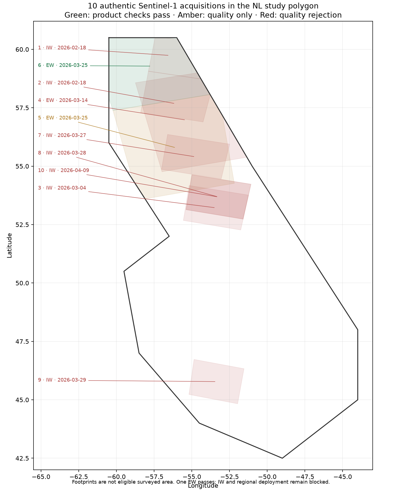

# Sentinel-1 acquisition suitability investigation, v3

**Roadmap step 2 is still incomplete.** Ten authentic CDSE products (three EW,
seven IW; 7,676,577,999 compressed bytes) were downloaded and independently
verified. One northern Labrador EW product passes the fixed nine-window SNAP
comparisons plus the unchanged whole-image and NL marine quality checks.
All seven new IW products fail the 5% non-positive-power limit. The best IW
result is 6.201%; its nine scientific comparisons pass, but it is rejected for
fresh detection. Credentials worked; the remaining blocker is processing/data
usability, not access.

This is an **adaptive development suitability search**, not a random regional
sample. Follow-up acquisitions were selected using metadata and earlier rejected
results, with each selection recorded before examining its measurement arrays.
Every rejected outcome is retained. No held-out SAR or chart arrays, pilot
submissions, frozen partitions, classifier labels or detection thresholds were changed.
The 5% preset is this project's research policy, not a published ESA or C-CORE standard.

## Current outcomes

The [current status](current-status.json) and [GIS coverage layer](current-coverage.geojson) link the representative comparison
reports. Whole-image fractions count all finite signed corrected measurement
pixels, including valid negative values. They are **not false-alarm rates**.

| Map | Acquisition UTC | Mode | Whole-image HV non-positive | Outcome |
|---|---|---|---:|---|
| 1 | 2026-02-18 10:03:12 | IW | 55.495% | Quality rejected |
| 2 | 2026-02-18 10:03:37 | IW | 55.710% | Quality rejected |
| 3 | 2026-03-04 09:48:31 | IW | 18.872% | Quality rejected |
| 4 | 2026-03-14 21:16:36 | EW | 5.637% | Quality rejected |
| 5 | 2026-03-25 21:23:31 | EW | 1.904% | Radiometric pass; nonzero scene reference heights unsupported |
| 6 | 2026-03-25 21:24:36 | EW | 2.692% | Nine comparisons + full and marine quality pass |
| 7 | 2026-03-27 09:55:10 | IW | 28.864% | Quality rejected |
| 8 | 2026-03-28 09:48:23 | IW | 6.201% | Nine comparisons pass; quality rejected |
| 9 | 2026-03-29 09:41:23 | IW | 40.005% | Quality rejected |
| 10 | 2026-04-09 09:48:23 | IW | 22.655% | Quality rejected |



The hand-defined NL marine polygon is the shared research AOI, not a provincial
or maritime legal boundary. Catalogue footprints are not eligible surveyed area.
The Grand Banks IW acquisition fails (40.005% HV); operational southern NL
coverage remains unqualified. The passing EW footprint does not prove usable
coverage over all of Newfoundland and Labrador or all seasons.

## Passing EW example

`S1C_EW_GRDM_1SDH_20260325T212436_20260325T212536_006926_00E035_FB61_COG.SAFE`

The [EW report](ew-northern-qualified/report.json) records all nine fixed 512 × 512
windows. Raw HH/HV calibration, signed thermal-noise subtraction, incidence,
relative registration and uncorrected-power reprojection comparisons pass the
unchanged v2 limits. The [marine scan](ew-northern-qualified/marine-quality.json)
uses every source pixel centre inside the shared NL polygon and outside GSHHG
land with a 500 m coastal buffer. HV non-positive power is **2.692% whole-image**
and **3.510% marine-domain**; marine finite coverage is **99.865%**.

That report's `deployment_gate_open: true` is the validator's **single-product
processing decision**. It is not a scientific release or permission for broad
fresh detection. The enclosing [current status](current-status.json) keeps the
roadmap and deployment gates closed. The comparison COGs are explicitly
uncorrected-power geometry diagnostics, retained locally with
[their hashes](ew-northern-qualified/local-diagnostics-sha256.json); they are
not released detection products.

## Real IW comparison and reader correction

The [IW report](iw-northern-reference/report.json) re-executes the original nine
fixed windows on the March 28 Labrador Sea acquisition with lossless source
internal overviews preserved. All nine comparisons pass. HV quality remains
**6.201%**, so the validator exits nonzero and its deployment gate stays closed.
This separates correct processing from an observation's suitability for CFAR.

A different February 18 IW product originally failed before quality measurement
because the short-block fallback rejected all range profiles containing any zero
knots. Inspection found positive measured noise profiles with four zero edge
knots. The reader now retains those measured zeros and requires at least two
positive samples plus nonnegative values within the swath. It still rejects
missing, wholly zero fallback profiles, negative power and uncovered valid pixels.
It does not invent noise or floor signed corrected signal. The fresh full scan
then measures **55.710% HV** and **34.140% HH** non-positive power; it remains rejected.
The original reader failure and the separately bound replacement scan are both
preserved. The additional real short-block reference is documented separately
in [the edge diagnostic](iw-noise-edge/report.json). It passes all unchanged checks
on window `(18929, 17204, 213, 8286)`, with 1,691,646 finite matched pixels,
zero HH/HV sign mismatch and p95 corrected-HV error of 0.0000081 dB. There
are 19 distinct newly accepted SNAP references (nine EW, nine IW and this
additional diagnostic), plus a source-bound re-comparison of the EW references
after the edge correction. Passing these checks does not reverse any full-image
quality rejection.

The algorithm reference is [SNAP 14's Sentinel-1 thermal-noise operator](https://github.com/senbox-org/microwave-toolbox/blob/14.0.0/sar-op-calibration/src/main/java/eu/esa/sar/calibration/gpf/Sentinel1RemoveThermalNoiseOp.java),
including its nearest measured range vector within the annotated subswath when
no vector lies inside a short azimuth block. The [ESA thermal-denoising note](https://sentiwiki.copernicus.eu/__attachments/1673968/DI-MPC-TN-MPC-0392%20-%20Thermal%20Denoising%20of%20Products%20Generated%20by%20Sentinel-1%20IPF%202024%20-%202.2.pdf)
provides the documented workflow. Agreement on this diagnostic is not independent
field truth or whole-product noise-model qualification.

## Other engineering corrections

- Windows extended-length paths now reach the marine annotation parser. The
  real extracted product path previously failed; a behavioral regression failed
  before the correction and passes afterward.
- Scratch TIFF conversion preserves the publisher's internal overview scales.
  Losing them caused SNAP's GDAL reader to try creating sidecars on a read-only
  mount and recurse into a stack overflow. Existing incomplete scratch inputs
  are rejected; the corrected real IW runs pass. Full decoded pixels are
  independently hashed before accepting the lossless scratch view.
- Full quality scans use a configurable positive block-row count (32 for these
  executions), bounded GDAL cache and one numerical worker thread. Earlier
  attempts raised memory errors; resource controls do not alter thresholds.
- Download resumption and quality reuse fail closed on mismatched sources,
  policy or reader code. New reusable scans have explicit input/code bindings;
  historical unbound scans are published as historical evidence, not retroactively
  upgraded into accepted cache entries.

## Authenticity and execution evidence

Both the original [nine-download snapshot](report.json) and the additive
[ten-download continuation](continuation/report.json) retain acquisition plans,
public catalogue responses, archive hashes, extracted-file hashes and quality
outcomes. Every downloaded archive matches the independently re-queried live CDSE
catalogue byte count and MD5, passes ZIP CRC and has 13 passing manifest checksum
checks. The [CDSE OData documentation](https://documentation.dataspace.copernicus.eu/APIs/OData.html)
and [COG conversion documentation](https://documentation.dataspace.copernicus.eu/Data/Others/Sentinel1_COG.html)
explain provider access and the converted product format. These are authentic
Sentinel-1 HH/HV Level-1 GRD COG SAFE products, not simulated rasters.

Raw archives and extracted products stay at
`D:/CryoLens-data/sentinel1-step2-20261012/raw/`; scientific reference rasters and
scratch views also stay local. Credentials are read only from `.env` and are not
included in evidence. The dataset manifest and AOI hashes accompany the receipts.
The download guard refuses acquisitions in, or within seven days of, any frozen
test group. This deliberately conservative guard uses metadata only.

The [initial execution snapshot](initial-execution-snapshot/source-sha256.json)
records the early processor/driver bytes, before later corrections and formatting;
it does not represent all later executions. Each new completed processing run
has its own exact `executed-code.zip` and source inventory matched against its
report's six processing-module hashes. Git commits recorded during later
MLflow logging describe that logging checkout, not the earlier scientific execution.
Reference receipts bind the actual SNAP image, graph, source window, all linked
scratch inputs, and full output/header/sidecar inventories. Publishing rehashes
those inputs and outputs rather than trusting filenames or a log message.

The original Docker outage/restart rejection in the first snapshot is historical.
The user explicitly approved a restart, Docker recovered, and new references
ran on the same pinned SNAP image. The continuation records no service blocker.
The pilot review listeners remained running on their existing processes.

The completed [EW MLflow receipt](ew-northern-qualified/tracking_receipt.json)
and [IW MLflow receipt](iw-northern-reference/tracking_receipt.json) belong to
real post-hoc runs `e4eddcede6454125ab48eca81ff22968` and
`6c244371e400474d8f116bf4bd4f003b`. Both record the actual dirty logging checkout
and the completed report/configuration hashes; neither claims model training,
precision or a scientific release. Runtime package versions are recorded in
[the environment inventory](environment.json).

## Reproduction and remaining gate

Use the committed selection plans under `continuation/plans/`, the existing CDSE
credentials and enough independent storage. The download driver refuses unsafe
names, archive traversal, CRC/checksum disagreement, test-group overlap and low
disk space. Re-download one recorded plan into a fresh root, then use the exact
published configuration and preserved execution snapshot to repeat its processor.
Changing only a configuration's local input path changes its hash: create a new
execution report rather than presenting it as the historical one.

```powershell
$env:PYTHONPATH = "$PWD/src;$PWD"
$env:OPENBLAS_NUM_THREADS = '1'
$env:OMP_NUM_THREADS = '1'
$env:MKL_NUM_THREADS = '1'
$env:GDAL_CACHEMAX = '64'
python validation/acquire_sentinel1.py --plan docs/processing-validation/v3/continuation/plans/acquisition-plan-ew-second-followup.json --root D:/new-s1-validation --env-file E:/CryoLens/.env
python -m cryolens.preprocess.validation --config docs/processing-validation/v3/ew-northern-qualified/configuration.json --output-dir D:/new-s1-validation/ew-results --scratch-dir D:/new-s1-scratch --run-reference
```

The second command's published configuration points to the original local SAFE
location; adjust it for a new download root and retain the new configuration hash.
Build/use the documented pinned SNAP reference image from the v2 recipe first.
For a newly executed standard run, `validation/publish_validation_run.py` verifies
its inputs, outputs and execution-source snapshot before publication.
`validation/finalise_acquisition_report.py` rebuilds this summary from the published
standard runs and matching marine evidence, refusing to overwrite it.

To finish step 2, qualify representative usable IW observations and southern NL
coverage, not just additional downloads. If standard subtraction remains unsuitable,
a validated alternative needs matched signed-power, spatial and downstream
checks; the previous unqualified NERSC experiment is not assumed to solve it.
Whole-footprint geometry, independent absolute geolocation and seasonal availability
remain unmeasured. Precise-orbit correction and scientific release are not granted.
This investigation supplies no iceberg identity, precision, recall or empirical
false-alarm rate. Those still require the independent reference reviews.

## Local code verification

The final full suite passed **419 tests**; 14 archive-dependent detection tests
were skipped in the isolated checkout. Mypy passed 125 source/test files and the
five evidence drivers; Ruff and formatting passed 170 Python files. New regressions
exercise real long-path annotation reads, lossless overview preservation, measured
zero edge knots, immutable source-bound cache reuse and publication failure modes.
The long-path, overview and zero-knot regressions failed before their corrections.
Actual SNAP comparisons are separate scientific evidence, not mocked test outputs.

Git newline conversion is disabled for this version's intentional evidence byte
contracts. The publication regression verifies actual committed Git blobs against
recorded report hashes, alongside configuration, source ZIP and reference-receipt
inventories. Original source snapshots and measured hashes are not rewritten to
make a different checkout appear to have generated the historical results.

## Historical delivery review status (before approval)

The independent review found four issues after the measured executions. Graph
bytes and Windows UNC paths were corrected in the preserved pipeline commit
`8ebe1843`; actual Git checkout behavior and path formatting have regression tests.
All 409 portable tests pass locally (14 archive-dependent tests skipped), and
mypy, Ruff and formatting pass. The review retry stopped on external model
capacity before completing review, push or CI; no new PR has been published.

Two protective remedies await the required human decision: preventing occupied
SNAP prefixes from being overwritten, and adding original source inventories to
new marine receipts before aggregation. Existing marine measurements are retained
as historical results; their receipt lacks measurement/annotation input hashes,
so final provenance qualification and safe reuse remain provisional. Implement
new source-bound evidence additively; do not backfill historical execution claims.
The current status remains closed overall and does not grant scientific release.

## Approved protections and current evidence

The user approved R1 and R2. Both protections are implemented. Occupied SNAP
prefixes fail before Docker execution; an atomic reservation prevents concurrent
reuse and retains failed attempts. Logs and receipts use exclusive writes, and
idempotent receipt verification preserves the original bytes. Existing validation
reports are refused; bound quality reuse now reads `--reuse-full-scan-from`
into a new output directory instead of replacing its source report.

Marine schema 2 records original manifest, measurement and annotation byte hashes
before scanning and rechecks them afterward. Aggregation requires an exact match
to the processing report's original source inventory. Legacy unbound marine
receipts remain historical evidence and cannot qualify a new aggregate.

The [additive source-bound status](source-bound-approval/current-status.json)
was generated from newly executed full EW/IW scans and comparisons against the
verified, unchanged SNAP references. The [new marine receipt](source-bound-approval/ew-northern-qualified/marine-quality.json)
records eleven original processing inputs and the exact driver/reader/helper
execution hashes. Full EW HV remains 2.692%, marine HV 3.510%, and IW HV 6.201%.
Nine EW and nine IW scientific comparisons pass; IW and the enclosing release
gates remain closed. No historical report, recorded hash or original snapshot
was altered or silently backfilled. This rerun adds no new distinct SNAP execution.
The [real occupied-prefix check](source-bound-approval/occupied-prefix-check.json)
confirms the original log, receipt and reference TIFF remain byte-identical.

The actual source-bound execution is captured in the new `executed-code.zip`
archives. Its marine driver precedes a later import-order formatting change;
the recorded driver hash matches the archived executed bytes. Post-hoc MLflow
runs `12b2bb1d7b024cdbaf57e165a33e2b1c` and `9765facb1bd94323887670911b92cbcf`
record the actual dirty checkout and new completed-report hashes. They do not
rewrite the earlier runs or claim model training/detection performance.
