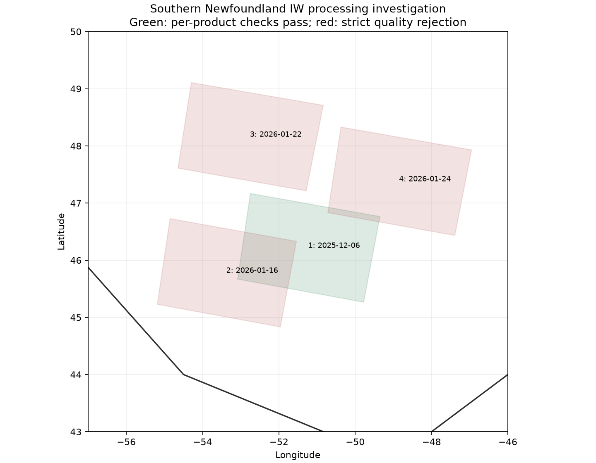

# Southern Newfoundland IW processing validation, v4

**Historical southern acquisition investigation; see [v5](../v5/README.md) for current complete-output qualification.** One real Grand Banks IW acquisition passed the unchanged full-grid, marine-domain and nine-window SNAP checks. The earlier [northern Labrador EW example](../v3/source-bound-approval/README.md) was also qualified. The enclosing step-2 and scientific-release flags in this investigation stayed closed. These retained acquisition outcomes do not grant province-wide, year-round or navigational readiness.

## Evidence packaging

Bulky catalogue, weather, annotation and official orbit payloads are preserved byte-for-byte in [ancillary-evidence.zip](ancillary-evidence.zip). Its [inventory](ancillary-evidence-inventory.json) records the archive SHA256 and every original relative path and SHA256. Extract it at this v4 directory before following links into `selection/`, either acquisition `metadata/` directory, or the orbit `official-eof/` directory. Original local files remain unchanged. The compact package avoids duplicating about 190 MB of ancillary text in a checkout. Reports, source-bound download receipts, plans, comparison receipts and executing-code snapshots remain directly accessible.

The two acquisition metadata directories include copied prior-search context from the historical publisher; that context is not part of the four-product southern selection. Future explicit-plan publications now copy only selected-plan evidence. The January and December southern selection payloads inside `selection/` establish this investigation's actual acquisition search.

## Measured outcome

Four authentic CDSE HH/HV IW COG SAFE products were downloaded, totaling **4,140,235,405 compressed bytes**. Each archive passes CRC, provider MD5/size and 13 manifest checks. Extracted source inventories are verified again against the live catalogue at publication. No mock imagery or invented noise was used.

| Acquisition UTC | Platform and area | Whole-grid HV non-positive | Outcome |
|---|---|---:|---|
| 2025-12-06 09:33:05 | S1C, central Grand Banks | **2.337%** | Nine comparisons, full and marine quality pass |
| 2026-01-16 09:41:24 | S1C, western Grand Banks | 26.884% | Nine comparisons pass; quality rejects |
| 2026-01-22 09:41:43 | S1A, waters east of Newfoundland | 11.239% | Full-grid quality rejects; no new reference comparison claimed |
| 2026-01-24 09:25:28 | S1A, eastern Grand Banks | 18.340% | Full-grid quality rejects; no new reference comparison claimed |

The qualifying product is:

`S1C_IW_GRDH_1SDH_20251206T093305_20251206T093330_005329_00A97F_8597_COG.SAFE`

Its [processing report](iw-december-qualified/report.json) contains nine fixed 512 × 512 comparisons across range and azimuth. Raw calibration, signed noise subtraction, incidence, relative registration and raw-power geometry checks pass the same v2 limits. The genuine independent reference is the pinned SNAP 14 image and graph, not a substitute Python implementation.

Its [source-bound marine scan](iw-december-qualified/marine-quality.json) checks every source pixel centre within the shared NL polygon and outside GSHHG land with the unchanged 500 m coastal buffer. It reports **2.337% HV non-positive power and 96.014% finite coverage**. For this wholly marine footprint, the whole-grid and marine counts coincide. Negative observations remain counted; they are not clipped, omitted or treated as nodata to secure acceptance.

The 5% rule is this project's frozen research policy, not a published C-CORE or ESA certification standard. These percentages are processing-quality statistics, **not false-alarm rates or iceberg-identification accuracy**. The report's single-product processing gate is distinct from the enclosing regional and scientific-release gates.

[Current source-bound status](current-status.json) · [Coverage GeoJSON](current-coverage.geojson)



Footprints are not eligible surveyed area. The hand-defined study polygon is a research AOI, not a legal provincial boundary or navigation chart.

## What the rejected cases establish

The [January S1C report](iw-january-rejected/report.json) independently repeats its full scan and passes all nine matched reference comparisons while retaining the **26.884%** rejection. Correct implementation and usable observations are different questions.

[Fixed-window diagnostics](diagnostics/iw-1-noise-diagnostic.json) show raw HV close to its annotated noise field on the rejected product; the [passing product](diagnostics/iw-4-noise-diagnostic.json) has substantially higher raw-to-noise ratios. The previously borderline March IW diagnostic is retained too. These ratios explain the observed signed-power distributions but do not independently establish the accuracy of the publisher's noise model. No empirical rescaling, positive floor or advanced denoiser was introduced. The older unqualified NERSC experiment is not represented as a solution.

## Selection and provenance

The complete public catalogue searches found **99 January 2026 and 128 December 2025** eligible southern HH/HV IW acquisitions. All pages are retained. The conservative acquisition-ID and seven-day test-group exclusions run before downloading measurements. Frozen test arrays, partitions, human pilot submissions and detector thresholds are unchanged.

Selection uses [ERA5 via Open-Meteo](https://open-meteo.com/en/docs/historical-weather-api) at recorded offshore model cells and acquisition-matched hours. These are reanalysis estimates at coarse resolution, not observed local winds or SAR truth. The initial three cases use separate January dates and passing original annotation/geometry guards. After their rejections, a stronger-wind December case was predeclared before its pixels were inspected. This is a deliberately adaptive engineering search, not an unbiased regional availability sample. A favourable centroid wind estimate did not ensure image quality.

The [pre-download/source join](selection/selection-source-verification.json) verifies that all four downloaded annotations and complete source inventories exactly match the original decisions. [Selection code](selection-execution/source-sha256.json), [diagnostic/reference helper code](evidence-assembly-execution/source-sha256.json) and each processing run's `executed-code.zip` preserve the actual generating bytes separately from later formatting and commits.

All 18 new SNAP executions are recorded once: nine rejected-case references plus nine passing-case references. Reusing their verified outputs for comparisons does not create additional executions. Large reference rasters and diagnostics stay local with recorded hashes.

Two genuine post-hoc MLflow runs record the completed reports, inputs, recipe, environment and actual dirty logging checkout at `eaee130d`: rejected case `bf5eaef47b524a0f879ca83fdbd852b0` and qualified case `b02f34d5c1da4137bfe50b31c7057bf3`. They demonstrate processing tracking, not model training or a registry deployment.

## Geometry evidence and limits

[Full-footprint metadata checks](diagnostics/iw-4-grid-diagnostic.json) examine all 210 annotated grid points per polarization. On the December example the nominal source-grid residual is **17.3 m median, 30.5 m p95 and 32.5 m maximum**. Those distances are consistency with product metadata using the same annotated orbit; they are not independently measured ground errors and are not interchangeable with the 20 m HH/HV co-registration policy. The matched SNAP tests separately assess relative geometry and reprojection.

[Official precise-orbit consistency](selection/orbit-consistency.json) for the two January cases finds position differences below 4.7 cm. No precise orbit was substituted or correction claimed. This auxiliary agreement does not supply image ground-control truth.

Broader seasonal and spatial availability, absolute field geolocation, uncertainty near footprint edges and regional operational release remain unqualified. Passing this December scene cannot justify processing every calm-water IW observation or claiming year-round southern NL coverage. Navigational products and broad fresh-imagery deployment remain disabled.

## Reproduce

Use the preserved plans in `selection/january/` and `selection/december/`, existing CDSE credentials and enough storage. Download with `validation/acquire_sentinel1.py`; run the preserved per-product configuration with `cryolens.preprocess.validation` and the pinned SNAP 14 image; then run `validation/assess_marine_domain.py` against the verified GSHHG regional cache. All replacement executions require new prefixes and output locations.

The output directory may contain verified reference outputs generated with `validation/run_planned_references.py` before the standard comparison. Omit `--run-reference` to consume those exact existing receipts. The standard run in this investigation independently repeats the full quality scan. Skipping the full scan cannot open its gate.

```powershell
$env:PYTHONPATH = "$PWD/src;$PWD"
$env:OPENBLAS_NUM_THREADS = '1'
$env:OMP_NUM_THREADS = '1'
$env:MKL_NUM_THREADS = '1'
$env:GDAL_CACHEMAX = '64'
python validation/acquire_sentinel1.py --plan docs/processing-validation/v4/selection/december/acquisition-plan.json --root C:/new-s1-validation --env-file E:/CryoLens/.env
python -m cryolens.preprocess.validation --config docs/processing-validation/v4/iw-december-qualified/configuration.json --output-dir C:/new-s1-validation/processing --scratch-dir C:/new-s1-scratch --run-reference
```

The preserved configuration points to the original local input path; make a new configuration for a new root and keep its new hash. The exact original graph and configuration bytes are inside the execution snapshot. Source files are at `C:/CryoLens-data/sentinel1-south-20261012/raw/`; complete scratch views and reference outputs are retained locally.

`validation/finalise_southern_iw_report.py` replays the committed report package into a fresh destination. It verifies source joins, code/configuration bytes, all reference receipts, consistent independent full scans, marine counts and fixed policy before qualifying a product. Receipt scratch manifests and annotations must match processing provenance; scratch measurement hashes are not equated with differently encoded original COG measurements. Full-grid HH/HV counts, fractions, contiguous stripe aggregates and summary flags must agree with the unchanged quality policy, including acquisitions without processing comparisons. Successful scientific checks must satisfy their existing numerical predicates and finite/count constraints; registration displacement must agree with the shift norm on the archived graph's grid, and absolute median residual bias must not exceed its p95 absolute error within floating-point tolerance. Occupied status/coverage destinations are refused.

For future acquisition publication, pass each intended plan with repeated `--plan` arguments to `validation/publish_acquisition_search.py`. Conflicting product identities are refused; plan basenames that collide, including case-only collisions on Windows, receive numbered publication names while retaining exact input bytes and digests. Explicit-plan publication omits unrelated historical metadata. A selected product without a download receipt has status `download_unverified` and reason "Download receipt missing; download completion and integrity are unverified"; its map footprint is grey. Missing receipt evidence does not establish a metadata geometry rejection. Historical publications remain unchanged.

The preserved `aggregation-consumer/` snapshot records the original aggregation tool. The maintained consumer includes post-review protective checks; it is not the producing source for the immutable scientific reports, receipts or SNAP executions.

## Retained engineering failures

The third transfer was interrupted by a provider reset; range resumption returned HTTP 416. Its unverified original fragment was archived byte-for-byte and a clean retry passed all archive checks. An early diagnostic and reference-preparation helper failed on unprefixed Windows paths before producing scientific acceptance. Their executed bytes, failures and replacement locations are retained; future helpers use the existing extended-path adapter.

The initial explicit-plan publisher used two identical basenames and retained only the second plan in its `plans/` folder. That initial snapshot is unchanged. [The verified publication](acquisition-search-verified/report.json) exports unique plan names, all three consumed plans including the transfer retry, and their hashes. The [continuation note](publication-continuation.json) also retains the selector's historical "first three" text despite a one-product December limit; future plans record the actual limit explicitly. No scientific result or original hash was rewritten to fix packaging.
