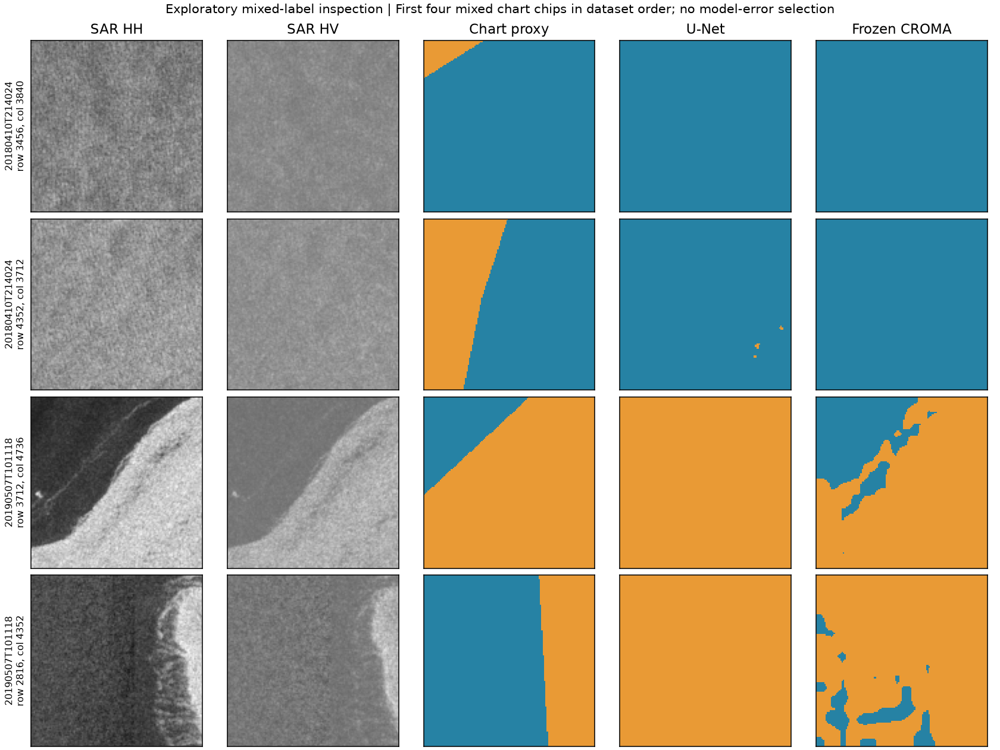

# Preliminary U-Net and frozen-CROMA development comparison

Executed 14 October 2026 on real, existing AI4Arctic data. This completes the
requested bounded baseline/frozen-encoder experiment and local research
lifecycle demonstration. Final test evaluation, operational target metrics and
the independent reference set remain incomplete. See the [model card](MODEL_CARD.md)
for intended uses and serving constraints.

## Measured chart agreement

| Validation measure | U-Net | Frozen CROMA + linear head |
|---|---:|---:|
| Pixel-aggregated mean IoU | 0.9185 | 0.9309 |
| Scene macro mean IoU | 0.7847 | 0.7901 |
| Acquisition-group macro mean IoU | 0.8739 | 0.8733 |
| Open-water IoU | 0.9763 | 0.9810 |
| Ice-affected IoU | 0.8607 | 0.8808 |
| Ice-affected precision | 0.8892 | 0.9474 |
| Ice-affected recall | 0.9640 | 0.9260 |
| Exploratory mixed-chart-chip mean IoU | 0.5371 | 0.6133 |

CROMA's pooled score is 1.24 percentage points higher in this run, while its
group macro score is slightly lower and ice recall is lower. **There is no
demonstrated reliable winner.** A single seed, six epochs and validation-based
checkpoint selection are preliminary development results. No independent final
test was opened, no confidence interval is claimed, and no target detection or
iceberg-identification accuracy follows from these numbers.

The training-majority predictor's pooled validation mean IoU is 0.4336.
Validation contains 2,598,634 scored samples, of which 2,253,795 are chart water
and 344,839 are chart ice affected. These are nominal 80 m samples, not field
observations or independent statistical replicates.

## Coverage and easy-interior bias

Prepared 960 training chips from 30 scenes / 20 acquisition groups, and 160
validation chips from 10 scenes / seven groups. Three eligible training records
had no chips meeting the predeclared support rules and were recorded as excluded.
The frozen manifest, groups and source aliases remain unchanged.

**149 of 160 validation chips contain only one chart class.** Only 11 contain
both water and ice labels; their exploratory results above are substantially
lower. This post-training subset inspection was selected solely by chart-class
presence, applied to both models, and never used to pick checkpoints or tune
settings. It is not a separate held-out experiment or an independent ice-edge
reference. Coarse chart polygons also have spatial/time uncertainty.



The four mixed examples use the first four mixed-chart chips in original dataset
order. [Selection](mixed-illustration-selection.json) and
[exploratory metrics](mixed-chart-analysis.json) record this post-training view.
[The original scene-order illustration](development-examples.png) shows the
first chip from each of the first four validation scenes, including homogeneous
interiors. Neither display selection changes the complete 160-chip metrics.

## What actually ran

[Predeclared protocol](protocol.md), [configuration](../../../configs/seaice-development-v1.json),
[dataset summary](dataset-summary.json), [complete measured comparison](comparison.json)
and [frozen-encoder verification](frozen-encoder.json) preserve the evidence.
Both models use the same physical HH/HV inputs, NL/coastal/valid support,
chart mapping, sampling order and six-epoch budget. Unknowns stay ignored.
CROMA's encoder weights remain byte-identical, with no gradients; only its
1,538-parameter head is trained. U-Net has 488,578 trainable parameters.

Actual hardware was an RTX 4070 Laptop GPU with 8 GB, PyTorch 2.8.0+cu128.
Measured optimizer-training portions took approximately 20.65 seconds (U-Net)
and 7.41 seconds (head). CROMA feature extraction took 2.32 seconds (train) and
0.74 seconds (validation). Preparation, hashing, installation, packaging and
tracking are outside these timings. Peak PyTorch-allocated memory was about
298 MiB; this does not describe total GPU driver/VRAM use. Seeded retraining is
not guaranteed bitwise identical across platforms.

MLflow recorded real training runs `d55dcef8c88f4eaa909df58a7d005729` (U-Net) and
`0168e1e10c3c4578acf2050a49648bc6` (CROMA head), with exact data/configuration,
metrics, model weights and executing source snapshots. The experiment executed
from a dirty feature checkout at parent `486f1aef`; the recorded actual source
hashes and [training snapshot](training-source.zip) describe those bytes. Later
review commits must not be substituted for the scientific execution source.
The upstream CROMA MIT license is included in the source package; data attribution
is AI4Arctic, Buus-Hinkler et al., DTU, DOI 10.11583/DTU.21316608.v3, CC BY 4.0.

## Model lifecycle demonstration

The smaller U-Net is used for packaging and CPU serving, an explicit engineering
choice rather than a claim that it won every metric. Actual epoch-1 and best
epoch-4 artifacts are registered with tensor signatures and named research
aliases. [Registry receipt](registry.json) verifies promotion 1 -> 2 and rollback
2 -> 1 by alias resolution and predictions. The corresponding
[container receipt](container-verification.json) records real Linux CPU Docker
inference, exact model/image hashes, malformed-input rejection and rollback.

Earlier registry/container attempts exposed an MLflow integer/string-version
compatibility issue. Their failed executions and initial registry records remain
local; replacements use new locations. The guarded serving parser checks NPY
headers before allocating arrays. Fixed inputs are finite float32 physical-dB
HH/HV with shape [1,2,128,128]; output is two class-score maps. Users must retain
the original valid/land/unknown masks. Scores are not calibrated confidence.

This demonstrates a local research ML lifecycle. It does not demonstrate live
monitoring, automatic retraining, cloud deployment, fresh-SAFE model suitability,
operational target acceptance or an iceberg classifier. Research promotion is
not permission to enable the separately closed fresh-target deployment gate.

## Reproduce

Create a new versioned configuration with your raw-data/cache/output paths and
the same scientific rules. Save it as `configs/seaice-development-local.json`;
set `dataset_root` to the absolute preparation output (`E:/new-dataset` below)
and `tracking_uri` to a new local database before preparation. Keep that
configuration unchanged through training and lifecycle registration so its
receipt hashes agree. Install the locked research extra on CPU for software
verification; CUDA scientific training uses the separately recorded official
PyTorch CUDA build. No ordinary environment is silently converted to GPU.

```powershell
uv sync --frozen --extra dev --extra tracking --extra research
uv run --frozen pytest tests/unit/test_segmentation_research.py tests/research/test_segmentation_torch.py
# Use a CUDA-enabled Python for the fixed scientific configuration.
python -m cryolens.segmentation prepare --config configs/seaice-development-local.json --project . --output E:/new-dataset
python -m cryolens.segmentation train --config configs/seaice-development-local.json --project . --dataset E:/new-dataset --output E:/new-training
python -m cryolens.segmentation lifecycle --config configs/seaice-development-local.json --project . --dataset E:/new-training --output E:/new-registry
python validation/validate_research_container.py --registry E:/new-registry/registry.json --output E:/new-container-validation --image your-qualified-image
```

Output directories must be new. Preserve failed runs; do not overwrite old
receipts. The official CROMA checkpoint is fetched separately and must match the
protocol checksum. Raw imagery, cached arrays, model binaries and credentials
remain outside Git. Release packaging supplies the qualified small inference
artifact and its checksum; the 778 MB CROMA base download is not embedded.

The container recipe is in `deployment/seaice.Dockerfile`, with a pinned base and
runtime requirements. Build from a minimal context containing that recipe as
`Dockerfile`, `seaice-requirements.txt` copied from
`deployment/seaice-requirements.txt`, and `service.py` copied from
`src/cryolens/segmentation/service.py`. Bind only the qualified model read-only;
publish its inference port on 127.0.0.1. The full source repository or `.env`
must not enter the image context.

## Remaining roadmap work

Step 5 has a real preliminary U-Net/frozen-CROMA result; longer training, multiple
seeds, fine-tuning if justified, broader boundary-sensitive evaluation and a
separately locked test release remain. Step 7 has actual local tracking,
signatures, registry, container inference and promotion/rollback; operational
MLOps remains unclaimed. Step 8 is a research release candidate, subject to final
review, CI and delivery. Step 4 consistency/adjudication and step 6 target metrics
are still pending. The protected January/September test cohort remains closed
to this experiment; pilot annotations and processing-quality thresholds are unchanged.

## Additive cache-bound lifecycle verification

Registration now verifies the exact training dataset receipt, frozen manifest and
configuration binding, validation-cache checksum and bounded path before any
array read or registry write. Changed arrays, test-marked receipts and escaped
cache paths fail closed. A new [guarded registry execution](registry-guarded.json)
and [container verification](container-guarded-verification.json) repeated the
actual 1 -> 2 -> 1 rollout with the same trained model bytes and unchanged 1e-5
inference tolerance. [Execution binding](guarded-execution.json) records the
receipts. Original training, registry-v2 and container-v3 records remain intact.

## Additive portable-candidate verification

The [independent portability receipt](portability-verification.json) verifies the
candidate ZIP checksum, CRCs and all seven manifest hashes, then a fresh wheel
installation and qualified U-Net inference outside the checkout. Both model
hashes match the guarded registry; all 100 packaged Python modules match submitted
head `548dc2f3` after newline normalization. The real development request matches
saved predictions within `1.19e-7` at unchanged `atol=1e-5`, `rtol=0`; malformed
and hostile-header requests return 422, and research metadata is verified.

This check reuses separately installed research/geospatial dependencies through
a `.pth` file and runs inference on CPU with the existing PyTorch CUDA build. It
does not establish clean dependency resolution or a CPU-only installation; locked
CPU dependency resolution remains a CI check. No protected test arrays were
opened and no training or preprocessing was rerun. Final reviewed-head release
assembly and CI remain pending; this receipt is local research-candidate evidence.
